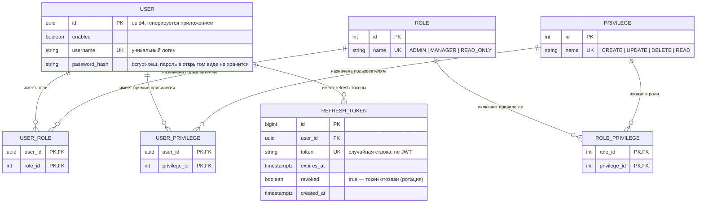

## Структура Базы данных

## Замечания к схеме

- `users.id` — UUID (uuid4): генерируется приложением при создании, без
  последовательности/autoincrement (в JSON API и JWT-клейме `uid` — строкой).
- Колонка `password_hash` (вместо `password`): колонка хранит bcrypt-хеш,
  имя говорит об этом явно. Колонки `first_name`/`last_name`/`org_id` удалены
  миграцией 20261020_drop_user_names_org.
- Эффективные привилегии пользователя = объединение привилегий его ролей (ROLE_PRIVILEGE)
  и прямых привилегий (USER_PRIVILEGE). Это объединение кладётся в access-токен.
- Новому пользователю при регистрации назначается роль `READ_ONLY`.
- Таблица `refresh_token` (в ER-диаграмме — REFRESH_TOKEN) добавлена для хранения
  refresh-токенов: она позволяет делать ротацию (старый токен отзывается при выдаче нового)
  и в будущем реализовать logout.
